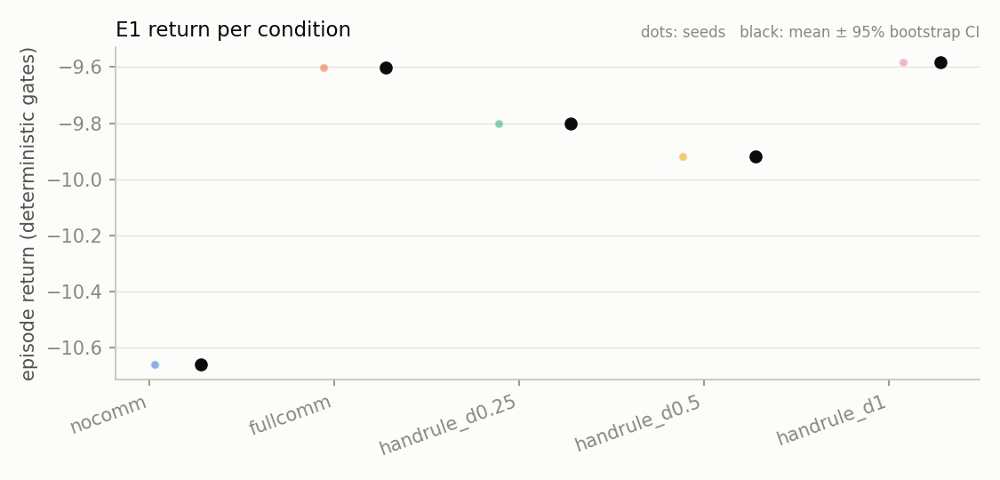
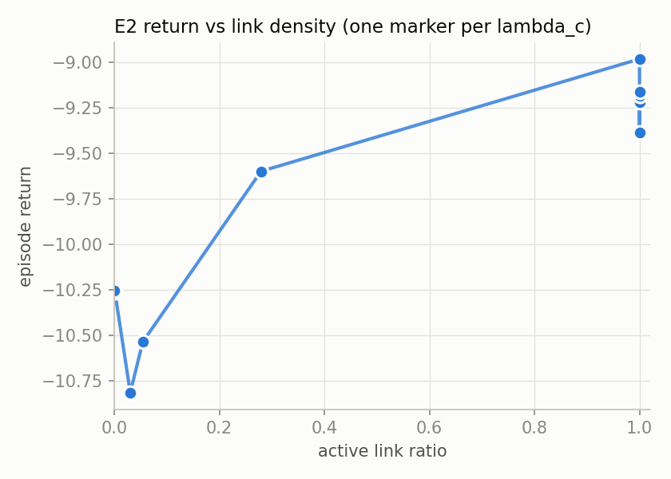
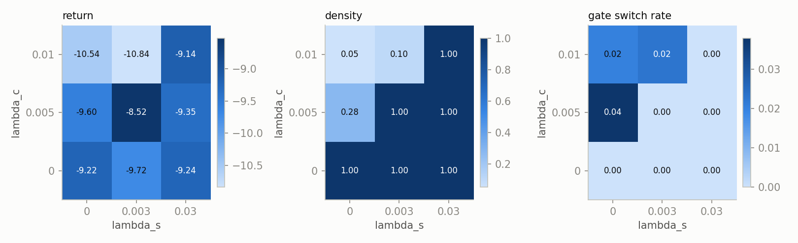
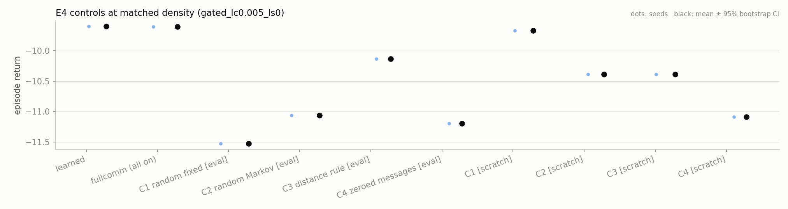
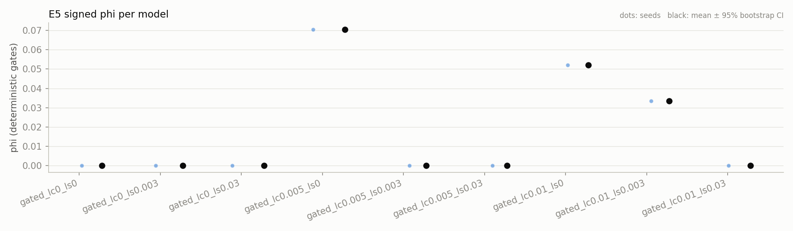
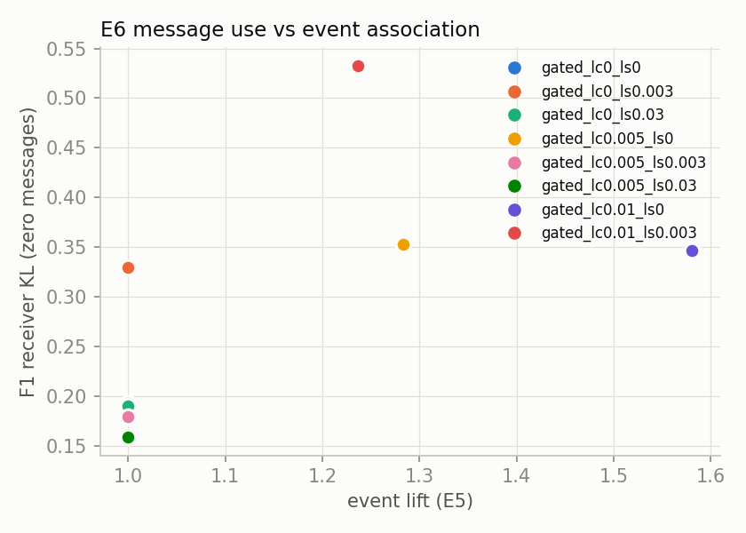
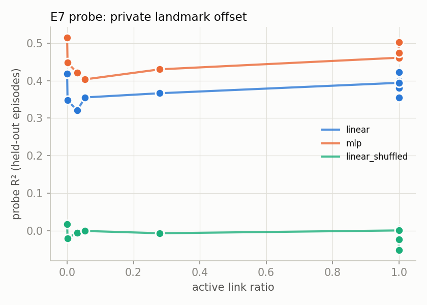
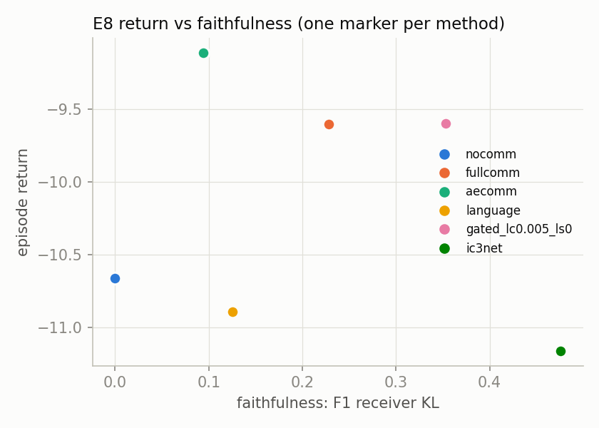
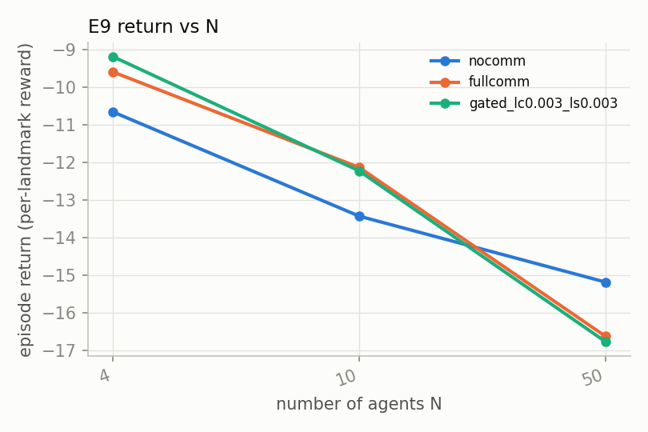

# Learned gated communication in cooperative MARL: results (seed 0, GPU)

This report covers experiments E1–E9 from `Detailed Experiment Specs, Code-Generation Prompt, and References.md`. All runs use the code in this repository. Every model was trained on one GPU with **one seed (seed 0)**. Across-seed confidence intervals are therefore not available, and the results below are preliminary. For each comparison, the report gives the within-seed evaluation uncertainty (section 4).

## 1. Summary

1. **The task is valid (E1).** All five pass criteria hold. Communication improves return (FullComm −9.60 vs NoComm −10.66, paired z = 1.9), but success rates are equal within noise (0.59 vs 0.64, ± 0.05).
2. **The amount of gating is all-or-nothing, not a smooth function of λc (E2).** At λc ≤ 0.004 and at λc = 0.006, every link stays on. λc = 0.005 gives 28 % density. λc ≥ 0.008 gives ≤ 5 %, and λc ≥ 0.03 collapses to 0 %. The response is not even monotonic (0.006 stays on while 0.005 goes to 28 %).
3. **At 28 % density the team loses little (E2, E4).** Its return equals FullComm's (−9.60 vs −9.60). At ≤ 5 % density, return drops to about the NoComm level (−1.0 to −1.6 relative to the unpenalized model, z ≈ −3).
4. **Learned gating does not beat a random mask trained from scratch (E4).** Learned 28 % gating clearly beats random, Markov and distance masks imposed at test time on the FullComm model. However, a random fixed mask at the same density, trained from scratch, reaches the same return (−9.67, z = 0.1). On this seed, learning chose *how many* links to keep, not demonstrably *which* ones.
5. **The switching penalty prevents sparsification (E3).** With λs > 0, gates stayed on at λc = 0.005, and at λc = 0.01 with λs = 0.03. A matched-density test of persistence (RQ2) was therefore only possible at density ≈ 1, where switching is zero. RQ2 is not answered.
6. **Sparse gates are associated with the task event, weakly (E5).** φ = 0.03–0.07, lift 1.24–1.58, p ≤ 0.001 against a 1,000-shift circular null, and the effect survives distance stratification. AUROC is only 0.51–0.54.
7. **Messages are used and carry private information, but are not human-readable (E6, E7).** Zeroing messages costs 1.6–3.9 return in communicating models. A linear probe recovers private landmark offsets (R² 0.32–0.42; shuffled baseline ≈ 0). The targeted counterfactual (F4) is at chance.
8. **Method comparison (E8).** AE-Comm has the best return (−9.11). The language variant is the most readable (96 %) but no better than NoComm on return. Sparse gating matches FullComm's return with 28 % of the bits.
9. **Scale (E9).** Communication helps at N = 10 (z = 3.5) and with a smaller observation radius (z = 3.7). At N = 50 every model fails (success 0), so the N = 50 and N = 50 → 100 results reflect under-training, not a scaling effect.

## 2. Setup

| Item | Value |
| --- | --- |
| Hardware | NVIDIA GeForce RTX 5080 Laptop GPU (16 GB), Intel Core Ultra 9 275HX, 30 GB RAM |
| Software | Linux 7.0, Python 3.12.3, JAX/jaxlib 0.6.2 with `jax[cuda12]` (CUDA 12.9 wheels), Flax 0.10.7, optax 0.2.8 |
| Task | Cooperative navigation, N = 4 agents and 4 landmarks, `obs_radius` 0.5, 50 steps per episode, K = 10 neighbour mask |
| Training | MAPPO, 1,500 updates × 64 environments × 50 steps = 4.8 M environment steps per run (N = 50: 16 environments) |
| Penalty schedule | λ = 0 for the first 20 % of training, then a linear ramp over 30 %. Gates initialised near on (P(g > 0) ≈ 0.96) |
| Evaluation | 100 episodes per model, deterministic gates (plus a stochastic-gate log). All models see the same 100 initial layouts |
| Seeds | 1 (seed 0) for every condition |
| Compute | 55 trained models (51 in `runs/core`, 4 pilot runs), about 3 h 50 min of wall time on the GPU, 4–6 runs in parallel |

**Changes from the README defaults**

- One seed instead of 5.
- CUDA JAX installed in `.venv` (the README's documented GPU option). No code was changed.
- The λ grids were re-calibrated (section 3).
- Independent conditions were trained in parallel, one process per condition, using the scripts' own `train_runs()`. Each experiment script was then run with `--seeds 0` to evaluate and analyse the cached models. Running the scripts sequentially would produce the same runs (same names and overrides).

## 3. How the λ values were chosen

1. **Pilot** (`--pilot`, 500 updates). λc = 0.01 → 16 % density, 0.03 → 6 %, 0.1 → 0 % (collapse). The README's default grid (0.01–1) therefore lies almost entirely in the collapsed regime. The pilot was stopped after 4 of 7 λ values, because the larger values were known to collapse.
2. **First full sweep**: λc ∈ {0, 0.0003, 0.001, 0.003, 0.01, 0.03, 0.1}. At the full budget, density jumped from 1.0 (λc = 0.003) to 0.05 (λc = 0.01), with nothing in between.
3. **Gap fill**: λc ∈ {0.004, 0.005, 0.006, 0.008}. Only λc = 0.005 gave an intermediate density (0.28).

Final choices:

- **E2 and E7:** all 11 λc values.
- **E3, E5 and E6:** λc ∈ {0, 0.005, 0.01} × λs ∈ {0, 0.003, 0.03}. λs was scaled down by the same factor as λc relative to the README defaults.
- **E4 and E8:** the learned model is `gated_lc0.005_ls0`.
- **E9:** λc = λs = 0.003. This was chosen before the gap fill, so the E9 gated models are dense (see section 6).

First-pass outputs (E3–E6 with λc ∈ {0, 0.001, 0.01}, E4 and E8 with λc = 0.003) are kept in [results/archive_v1/](results/archive_v1/).

## 4. How to read single-seed numbers

Each model is evaluated on the same 100 layouts, so two models can be compared episode by episode. The standard error of a single model's mean return is ±0.40–0.56, and of its success rate ±0.05. The table below gives paired differences (A − B) with their standard error. |z| ≥ 2 suggests a real difference *for this seed*. These numbers capture evaluation noise only. Variation from one training seed to the next is not measured and is probably larger.

| Exp | Comparison | Δ return | Paired SE | z |
|---|---|---|---|---|
| E1 | `fullcomm` − `nocomm` | +1.06 | 0.55 | +1.9 |
| E1 | `handrule_d1` − `nocomm` | +1.08 | 0.56 | +1.9 |
| E1 | `handrule_d0.25` − `nocomm` | +0.86 | 0.55 | +1.6 |
| E2 | `gated_lc0.005_ls0` (28 %) − `gated_lc0_ls0` (100 %) | −0.38 | 0.41 | −0.9 |
| E2 | `gated_lc0.008_ls0` (3 %) − `gated_lc0_ls0` | −1.60 | 0.42 | −3.8 |
| E2 | `gated_lc0.01_ls0` (5 %) − `gated_lc0_ls0` | −1.32 | 0.44 | −3.0 |
| E2 | `gated_lc0.03_ls0` (0 %) − `gated_lc0_ls0` | −1.05 | 0.38 | −2.7 |
| E2 | `gated_lc0.005_ls0` − `nocomm` | +1.06 | 0.48 | +2.2 |
| E3 | `gated_lc0.005_ls0.003` (100 %) − `gated_lc0.005_ls0` (28 %) | +1.07 | 0.39 | +2.7 |
| E4 | learned − C1 random fixed (scratch) | +0.07 | 0.46 | +0.1 |
| E4 | learned − C2 random Markov (scratch) | +0.79 | 0.45 | +1.8 |
| E4 | learned − C3 distance rule (scratch) | +0.79 | 0.48 | +1.6 |
| E4 | learned − C4 zeroed messages (scratch) | +1.49 | 0.48 | +3.1 |
| E4 | learned − FullComm | +0.00 | 0.43 | +0.0 |
| E8 | `aecomm` − `fullcomm` | +0.49 | 0.37 | +1.3 |
| E8 | `aecomm` − `nocomm` | +1.55 | 0.56 | +2.8 |
| E8 | `language` − `nocomm` | −0.23 | 0.58 | −0.4 |
| E8 | `ic3net` − `nocomm` | −0.50 | 0.60 | −0.8 |
| E9 | `fullcomm_N10` − `nocomm_N10` | +1.29 | 0.37 | +3.5 |
| E9 | `fullcomm_N50` − `nocomm_N50` | −1.44 | 0.24 | −5.9 |
| E9 | `fullcomm_smallRobs` − `nocomm_smallRobs` | +2.26 | 0.62 | +3.7 |

The CI columns in the experiment JSON and CSV files are `NaN`, because bootstrapping across one seed is undefined. The IQM equals the single value.

## 5. Results by experiment

### E1 Task validation: passes

| Condition | Return | Success | Final coverage | Link density | Event rate |
|---|---|---|---|---|---|
| NoComm | −10.66 | 0.64 | 0.82 | 1.00 (messages × 0) | 0.22 |
| FullComm | −9.60 | 0.59 | 0.78 | 1.00 | 0.25 |
| Hand rule d = 0.25 | −9.80 | 0.62 | 0.80 | 0.02 | 0.22 |
| Hand rule d = 0.5 | −9.92 | 0.65 | 0.82 | 0.14 | 0.24 |
| Hand rule d = 1 | −9.58 | 0.64 | 0.79 | 0.49 | 0.25 |

- **Checks.** FullComm beats NoComm ✅, not at ceiling ✅, hand rule beats NoComm ✅, event rate in 10–30 % ✅ (24.9 %), event rate varies with distance ✅.
- **Event rate by sender–receiver distance** (in units of `obs_radius`): 0–0.5: 0.02, 0.5–1: 0.13, 1–1.5: 0.25, 1.5–2: 0.28, > 2: 0.27.
- **Caveat.** The check passes on return only. Success favours NoComm by 0.05, which is within one standard error. Communication's benefit here is modest.



### E2 Sparsity sweep (RQ1)

| λc | Density | Return | Success | Gate switch rate | Mean run length |
|---|---|---|---|---|---|
| 0 | 1.000 | −9.22 | 0.63 | 0.000 | 50.0 |
| 0.0003 | 1.000 | −9.18 | 0.65 | 0.000 | 50.0 |
| 0.001 | 1.000 | −9.18 | 0.58 | 0.000 | 50.0 |
| 0.003 | 1.000 | −9.39 | 0.64 | 0.000 | 50.0 |
| 0.004 | 1.000 | −8.98 | 0.74 | 0.000 | 49.9 |
| **0.005** | **0.279** | **−9.60** | 0.59 | 0.038 | 9.8 |
| 0.006 | 1.000 | −9.16 | 0.57 | 0.000 | 50.0 |
| 0.008 | 0.030 | −10.82 | 0.59 | 0.015 | 2.2 |
| 0.01 | 0.054 | −10.54 | 0.52 | 0.020 | 2.8 |
| 0.03 | 0.001 (collapse) | −10.27 | 0.60 | 0.001 | 1.1 |
| 0.1 | 0.000 (collapse) | −10.25 | 0.55 | 0.000 | 0.0 |

**Readout.** Agents can drop to about 28 % of links with no measurable loss: the knee density is 0.28, and Δ return = −0.38 (z = −0.9). Below about 5 %, return falls to the NoComm level.

**The density curve is not smooth.** Each run ends near "all on" or "almost all off". Whether a run tips over looks partly random: 0.006 stays on while 0.005 does not. During the λ ramp, the gates turn off for the whole population together, rather than link by link.

Gate collapse (density < 2 %) occurs at λc ≥ 0.03. Final checkpoints at λc ≥ 0.008 are at or near collapse.



### E3 Persistence at matched density (RQ2): not answerable with this grid

| λc \ λs | 0 | 0.003 | 0.03 |
|---|---|---|---|
| 0 | dens 1.00, ret −9.22 | dens 1.00, ret −9.72 | dens 1.00, ret −9.24 |
| 0.005 | dens 0.28, ret −9.60, run length 9.8 | dens 1.00, ret −8.52 | dens 1.00, ret −9.35 |
| 0.01 | dens 0.05, ret −10.54, run length 2.8 | dens 0.10, ret −10.84, run length 5.1 | dens 1.00, ret −9.14 |

- **The switching penalty keeps links on.** Turning a gate off is itself a switch, so with λs > 0 the gates usually stay in their initial "on" state.
- **The only sparse λs > 0 model** is λc = 0.01, λs = 0.003. Compared with λs = 0 there, its density doubled (0.05 → 0.10) and its mean link-run length almost doubled (2.8 → 5.1 steps), while the per-step switch rate stayed similar (0.020 → 0.023).
- **The script's matched-density comparison** finds only the 0.9–1.0 bin, where all switch rates are 0 (Δ return +0.02, CI [−0.29, +0.39]). Persistence effects at matched intermediate density therefore could not be tested.
- **Mask-driven switch rate is 0 at N = 4.** All 3 neighbours are always inside the K = 10 mask, so every switch is gate-driven.



### E4 Matched-mask controls (learned model `gated_lc0.005_ls0`, density 0.279, switch rate 0.038)

| Condition | Return | Learned − control | Achieved density | Achieved switch rate |
|---|---|---|---|---|
| Learned | −9.60 | – | 0.279 | 0.038 |
| FullComm (all on) | −9.60 | +0.00 | 1.000 | 0 |
| C1 random fixed (eval, on FullComm model) | −11.53 | +1.93 | 0.272 | 0.000 |
| C2 random Markov (eval) | −11.06 | +1.47 | 0.276 | 0.038 |
| C3 distance rule (eval, d = 0.71) | −10.13 | +0.53 | 0.291 | 0.039 |
| C4 zeroed messages (eval, on learned model) | −11.19 | +1.59 | 0.292 | 0.038 |
| C1 random fixed (trained from scratch) | −9.67 | +0.07 | 0.272 | 0.000 |
| C2 random Markov (scratch) | −10.39 | +0.79 | 0.275 | 0.038 |
| C3 distance rule (scratch) | −10.39 | +0.79 | 0.269 | 0.041 |
| C4 zeroed messages (scratch) | −11.09 | +1.49 | 0.000 (gates closed) | 0 |

**Readout**

- **Test-time controls.** The learned gating beats every test-time control. However, these controls change the mask of a model trained with all links on, so part of the gap is distribution shift.
- **From-scratch controls.** A random *fixed* mask at the same density reaches the learned return (z = 0.1). By the spec's own readout ("learned = C1 ⇒ it only removed links"), on this seed learning mainly picked the number of links. Time-varying random masks and the distance rule trained from scratch are somewhat worse (z ≈ 1.6–1.8).
- **Zeroed messages.** C4 shows the messages matter: zeroing them costs about 1.5 return, both at test time and when trained that way. Trained from scratch with zero messages, the gates close completely, because links carry nothing worth paying for.



### E5 Event association (RQ3): significant but small, only in sparse models

The event is "sender sees an uncovered landmark that the receiver cannot see". Models with density 1.0 have constant gates, so φ = 0 and lift = 1 by construction. Only sparse models are informative:

| Model | Density | φ | Lift | AUROC | φ (distance-stratified) | φ − null mean | p (1,000 circular shifts) |
|---|---|---|---|---|---|---|---|
| `gated_lc0.005_ls0` | 0.28 | 0.070 | 1.28 | 0.537 | 0.057 | 0.134 | ≤ 0.001 |
| `gated_lc0.01_ls0` | 0.05 | 0.052 | 1.58 | 0.514 | 0.049 | 0.055 | ≤ 0.001 |
| `gated_lc0.01_ls0.003` | 0.10 | 0.034 | 1.24 | 0.512 | 0.023 | 0.044 | ≤ 0.001 |

**Readout**

- **Strength.** Active links co-occur with the event more often than a persistence-preserving null predicts, and the association survives stratifying by distance. The effect is weak (φ ≤ 0.07). p = 0.001 is the smallest value 1,000 shifts can resolve.
- **Persistence.** With λs = 0.003 (λc = 0.01), lift is lower (1.24 vs 1.58), but density differs (0.10 vs 0.05), so this is not a matched-density comparison.
- **Interpretation.** This is association, not causation.



### E6 Message use (faithfulness)

| Model | Density | Event lift | F1 KL (zero all) | F2 KL event / random | F3 KL other sender / episode | F4 match rate | Return drop: F1 zero / F3 shuffle |
|---|---|---|---|---|---|---|---|
| FullComm | 1.00 | 1.00 | 0.228 | 0.177 / 0.136 | 0.62 / 0.57 | 0.56 | 3.23 / 1.75 |
| `gated_lc0_ls0` | 1.00 | 1.00 | 0.193 | 0.143 / 0.100 | 0.55 / 0.43 | 0.52 | 2.81 / 2.12 |
| `gated_lc0.005_ls0` | 0.28 | 1.28 | 0.353 | 0.384 / 0.343 | 0.69 / 0.77 | 0.47 | 1.59 / 0.74 |
| `gated_lc0.005_ls0.003` | 1.00 | 1.00 | 0.180 | 0.121 / 0.107 | 0.47 / 0.40 | 0.55 | 3.91 / 2.87 |
| `gated_lc0.01_ls0` | 0.05 | 1.58 | 0.347 | 0.329 / 0.268 | 1.30 / 1.16 | 0.44 | −0.41 / −0.10 |
| `gated_lc0.01_ls0.003` | 0.10 | 1.24 | 0.533 | 0.335 / 0.356 | 1.83 / 1.79 | 0.51 | 0.84 / 0.39 |

**Readout**

- **Messages change receiver actions.** F1 KL is 0.18–0.53, and zeroing or shuffling messages costs 1.6–3.9 return in the denser models. They are not decorative.
- **Per message, influence is larger in sparse models.** When a link is open there, it matters more (higher KL per affected receiver).
- **The 5 % model** (`lc0.01_ls0`) loses nothing when messages are removed. At that density, too few links are open to matter in closed loop.
- **Event-time links are not special.** Ablating links at event times has about the same influence as ablating the same number at random times (0.38 vs 0.34 for the 28 % model).
- **F4, the pre-registered targeted counterfactual, is at chance** (0.44–0.56). Receivers do not move toward a substituted landmark position in the predicted direction.



### E7 Message content probe

| Model | Density | Private-landmark offset R²: linear / MLP / shuffled | Human-label accuracy: linear / shuffled |
|---|---|---|---|
| FullComm | 1.00 | 0.35 / 0.46 / −0.00 | 0.735 / 0.726 |
| `gated_lc0_ls0` | 1.00 | 0.42 / 0.46 / −0.02 | 0.714 / 0.701 |
| `gated_lc0.005_ls0` | 0.28 | 0.37 / 0.43 / −0.01 | 0.735 / 0.722 |
| `gated_lc0.01_ls0` | 0.05 | 0.36 / 0.40 / −0.00 | 0.732 / 0.731 |
| `gated_lc0.1_ls0` (collapsed) | 0.00 | 0.42 / 0.52 / 0.02 | 0.737 / 0.731 |
| NoComm | (messages × 0) | −0.01 | 0.737 / 0.737 |

**Readout**

- **Messages encode private landmark positions.** R² is well above the shuffled baseline at every density, including collapsed models. The probe reads the message the sender *produces*, whether or not any link delivers it, which is why collapsed models still score.
- **Messages are not human-readable.** Decoding the human compass label beats the shuffled baseline by at most 0.03.
- **Content is not use.** Combined with E6, messages contain information, receivers react to them, but not in the spatially predicted way (F4 at chance).



### E8 Method comparison (same backbone and budget, seed 0)

| Method | Return | Success | Faithfulness (F1 KL) | Probe R² | Readability | Bits / agent-step |
|---|---|---|---|---|---|---|
| NoComm | −10.66 | 0.64 | 0 | −0.01 | 0.737 | 0 |
| FullComm (RL messages) | −9.60 | 0.59 | 0.228 | 0.35 | 0.735 | 1,536 |
| AE-Comm | **−9.11** | 0.63 | 0.094 | 0.58 | 0.782 | 1,536 |
| Language (9 tokens) | −10.89 | 0.48 | 0.126 | 0.60 | **0.960** (direct) | **9.5** |
| Gated (λc = 0.005) | −9.60 | 0.59 | 0.353 | 0.37 | 0.735 | 429 |
| IC3Net-style (REINFORCE, per-sender gate, λc = 0.003; density 0.08) | −11.16 | 0.65 | 0.476 | 0.33 | 0.702 | 121 |

**Readout**

- **AE-Comm** has the best return and the most decodable continuous messages, but the lowest message influence. Its edge over FullComm is not significant on one seed (z = 1.3).
- **The language variant** is readable by construction, and the cheapest by far, but gains nothing over NoComm on return.
- **Gated communication** keeps FullComm's return at 28 % of the bits, and has the second-highest faithfulness.
- **IC3Net-style gating** keeps only 8 % of links, has the most influential messages, and has the worst return, although its success rate (0.65) is as high as any method. Return and success disagree here; with ± 0.05 standard error on success, neither difference is clear. Note that it was trained with λc = 0.003, which was chosen before the gap fill, while the gated row uses 0.005.
- **Cross-play** needs two seeds and is not reported.



### E9 Transfer and scale (gated rows use λc = λs = 0.003, which are dense: density 1.0)

| Condition | Return | Success | Density | Gate switch rate | Mask switch rate |
|---|---|---|---|---|---|
| FullComm N = 4 / 10 / 50 | −9.60 / −12.14 / −16.62 | 0.59 / 0.02 / 0.00 | 1 | 0 | 0 / 0 / 0.045 |
| NoComm N = 4 / 10 / 50 | −10.66 / −13.43 / −15.18 | 0.64 / 0.03 / 0.00 | – | – | – |
| Gated N = 4 / 10 / 50 | −9.19 / −12.23 / −16.76 | 0.62 / 0.00 / 0.00 | 1 | 0 | 0 / 0 / 0.046 |
| FullComm / NoComm / Gated, `obs_radius` 0.3 | −11.67 / −13.93 / −11.48 | 0.31 / 0.24 / 0.37 | 1 | 0 | 0 |

**Gate estimator swap (N = 4, λc = 0.003)**

| Estimator | λs = 0: density, switch rate, return, φ, lift | λs = 0.003: density, switch rate, return, φ, lift |
|---|---|---|
| Hard-concrete | 1.00, 0, −9.39, –, – | 1.00, 0, −9.19, –, – |
| Straight-through | 0.00, 0, −10.49, –, – | 1.00, 0, −9.83, –, – |
| REINFORCE | 0.13, 0.052, −9.85, +0.065, 1.44 | 0.62, 0.099, −9.86, −0.066, 0.88 |

**Zero-shot transfer N = 50 → 100 (frozen weights)**

| Model | Return at N = 50 | Return at N = 100 |
|---|---|---|
| FullComm | −16.62 | −16.26 |
| NoComm | −15.18 | −15.67 |
| Gated | −16.76 | −16.22 |

Success is 0 for all three models at both sizes.

**Training throughput and memory.** Measured separately, with one process alone on the GPU (40 updates, after compilation).

| N | Environments | FullComm env-steps/s (agent-steps/s) | Gated env-steps/s | Peak GPU memory |
|---|---|---|---|---|
| 4 | 64 | 24,300 (97 k) | 20,800 | 35 MB |
| 10 | 64 | 23,900 (239 k) | 19,200 | 131 MB |
| 50 | 16 | 4,270 (213 k) | 3,230 | 131 MB (FullComm), 259 MB (gated) |

The `fps` values stored in the E9 report JSON were recorded while 4–6 runs shared the GPU, so use the table above instead. For comparison, CPU training runs at about 2,400 env-steps/s at N = 4.

**Readout**

- **Communication.** The benefit holds at N = 10 (z = 3.5) and grows when agents see less (`obs_radius` 0.3: +2.26, z = 3.7).
- **N = 50.** No model learns the task with this budget (16 environments × 1,500 updates). NoComm being better there (z = −5.9) and the N = 50 → 100 transfer numbers describe under-trained policies and should not be read as scaling results.
- **Gate estimator.** The choice changes the sparsity outcome qualitatively. Hard-concrete stays on at λc = 0.003. Straight-through collapses without λs. REINFORCE settles at intermediate densities, with real switching, and with an event association (φ = +0.065, lift 1.44) similar to the sparse hard-concrete models.



## 6. Issues, deviations and work not done

| # | Issue | Effect | Status |
|---|---|---|---|
| 1 | **Single seed** (user choice) | No across-seed CIs (CI fields are `NaN`); conclusions are preliminary; E8 cross-play needs ≥ 2 seeds | Reported; within-seed paired SEs in section 4 |
| 2 | **λc response is all-or-nothing and non-monotonic** | E2 has one intermediate-density point (0.28); density-matched analyses have little to work with | Gap-fill runs added (λc 0.004–0.008); documented |
| 3 | **λs > 0 blocks sparsification** | E3 has no intermediate-density bin containing both λs = 0 and λs > 0; RQ2 is unanswered | Documented. Would need a λs warm-up after sparsification, or per-λs λc calibration |
| 4 | **E9 gated models used λc = 0.003** (chosen before the gap fill) | E9 gated rows are dense; the gated N-scaling and transfer rows do not test sparse gating | Not re-run (about 8 runs, including a 37-min N = 50 run). REINFORCE/STE rows still show estimator effects |
| 5 | **IC3Net trained with λc = 0.003**; the E8 gated row uses 0.005 | IC3Net and gated are not at the same λ | Documented |
| 6 | **N = 50 under-trained** (success 0) | E9 scaling and transfer conclusions cannot be drawn | Documented. Would need more updates or environments at large N |
| 7 | **E9 training fps measured under GPU sharing** | Stored fps understates throughput | Replaced by a clean benchmark (table above) |
| 8 | **E2 pilot stopped after 4 of 7 λ** | The pilot report has 4 points | Intentional: λ ≥ 0.1 was already collapsed |
| 9 | **E1 success does not favour communication** | The "FullComm beats NoComm" check rests on return | Documented (within ± 0.05) |
| 10 | E4 C4 (scratch) closed every gate | C4-scratch is effectively NoComm with gating parameters | Expected behaviour, documented |
| 11 | Harmless XLA autotuner warnings (`All configs were filtered out…`) in the logs | None | Ignored |

No experiment failed to run. Every training job and every experiment script exited with code 0.

## 7. Saved weights

Each trained model is stored in `runs/core/<run>/seed_0/` (pilot: `runs/pilot_core/<run>/seed_0/`):

| File | Contents |
| --- | --- |
| `params.msgpack` | Actor and critic weights (Flax msgpack, about 0.5 MB) |
| `config.yaml` | Full resolved config |
| `meta.json` | Wall time, throughput, peak memory, final training metrics |
| `train_metrics.csv` | Training curve |
| `eval_det.npz` and `eval_stoch.npz` | Evaluation logs with the full schema |

Total size: 646 MB (core) and 61 MB (pilot).

| Experiment | Runs (`runs/core/…`) |
|---|---|
| E1 | `nocomm`, `fullcomm`, `handrule_d0.25`, `handrule_d0.5`, `handrule_d1` |
| E2 / E7 | `gated_lc{0, 0.0003, 0.001, 0.003, 0.004, 0.005, 0.006, 0.008, 0.01, 0.03, 0.1}_ls0` |
| E3 / E5 / E6 | `gated_lc{0, 0.005, 0.01}_ls{0, 0.003, 0.03}` (plus first-pass `gated_lc0.001_ls{0.003, 0.03}`) |
| E4 | `C{1..4}_scratch_gated_lc0.005_ls0` (plus first-pass `C{1..4}_scratch_gated_lc0.003_ls0`) |
| E8 | `aecomm`, `language`, `ic3net` (plus E1 and E2 models) |
| E9 | `{fullcomm, nocomm, gated_lc0.003_ls0.003}_N{4, 10, 50}`, `…_smallRobs`, `gated_{ste, reinforce}_lc0.003_ls{0, 0.003}_N4` |

Load and evaluate a model:

```python
from core.utils import load_checkpoint
from eval import evaluate_run
cfg, params = load_checkpoint("runs/core/gated_lc0.005_ls0/seed_0")
summary = evaluate_run("runs/core/gated_lc0.005_ls0/seed_0", tag="det")   # cached in eval_det.json
```

## 8. Reproducing

```bash
.venv/bin/pip install "jax[cuda12]==0.6.2"            # GPU build of JAX (already installed)
export XLA_PYTHON_CLIENT_PREALLOCATE=false             # needed when several runs share the GPU
.venv/bin/python -m pytest tests -q                    # 35 passed
for s in scripts/e*_*.py; do .venv/bin/python $s --quick; done   # smoke test: all 9 pass
.venv/bin/python scripts/e1_task_validation.py   --seeds 0
.venv/bin/python scripts/e2_sparsity_sweep.py    --pilot --lambdas 0 0.01 0.03 0.1
.venv/bin/python scripts/e2_sparsity_sweep.py    --seeds 0 --lambdas 0 0.0003 0.001 0.003 0.004 0.005 0.006 0.008 0.01 0.03 0.1
.venv/bin/python scripts/e3_persistence_grid.py  --seeds 0 --lc 0 0.005 0.01 --ls 0 0.003 0.03
.venv/bin/python scripts/e4_matched_controls.py  --seeds 0 --lambda-c 0.005 --lambda-s 0
.venv/bin/python scripts/e5_event_association.py --seeds 0 --lc 0 0.005 0.01 --ls 0 0.003 0.03
.venv/bin/python scripts/e6_message_use.py       --seeds 0 --lc 0 0.005 0.01 --ls 0 0.003 0.03
.venv/bin/python scripts/e7_message_probe.py     --seeds 0 --lambdas 0 0.0003 0.001 0.003 0.004 0.005 0.006 0.008 0.01 0.03 0.1
.venv/bin/python scripts/e8_method_comparison.py --seeds 0 --lambda-c 0.005 --with-ic3net
.venv/bin/python scripts/e9_transfer_scale.py    --seeds 0 --lambda-c 0.003 --lambda-s 0.003
```

Note that IC3Net is cached under the plain name `ic3net`. Running the E8 command from scratch would train it with λc = 0.005, not 0.003 as here.

- **Results:** `results/e*/` (JSON, CSV, figures); first-pass versions in `results/archive_v1/`.
- **Logs:** per-job logs and `status.txt` in `logs/gpu_full/`; the clean throughput benchmark in `logs/gpu_full/bench_e9_clean.txt`.
