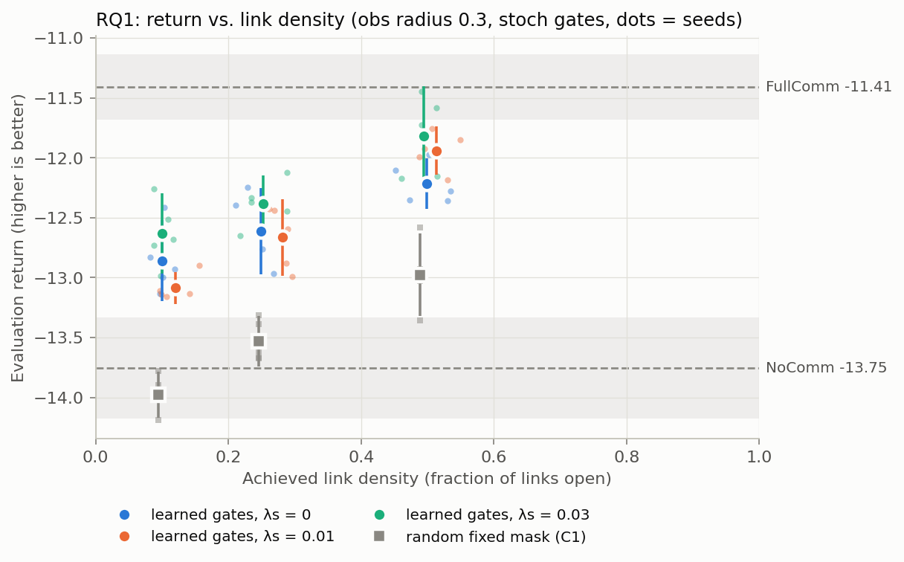
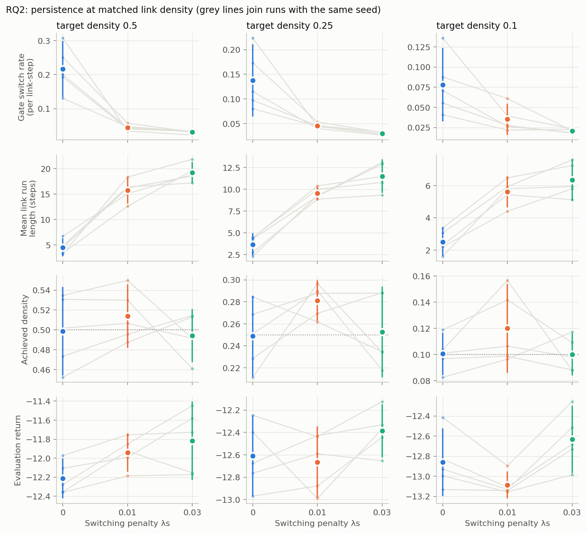
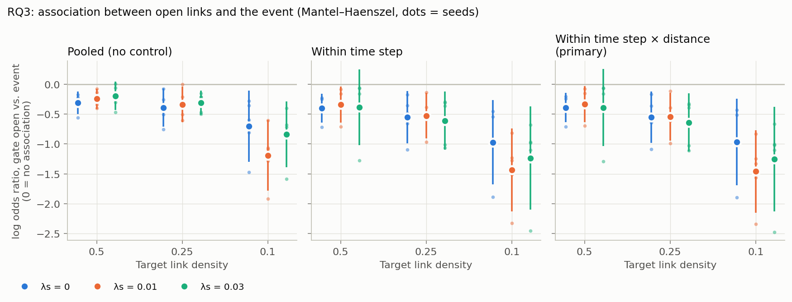
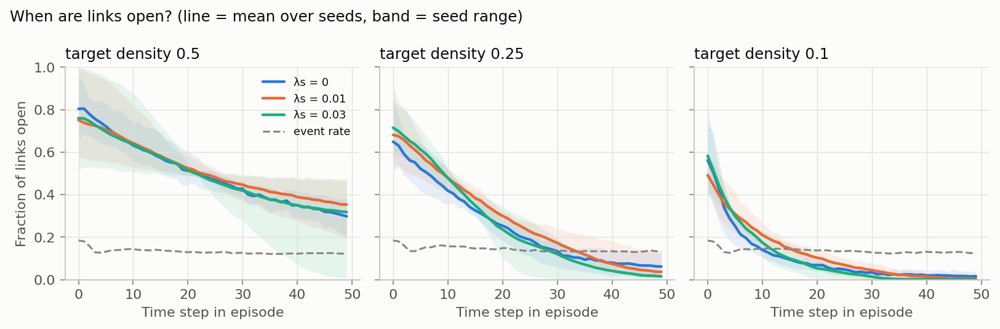
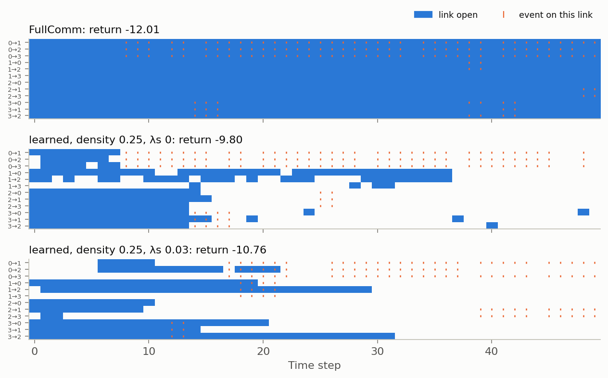

# Learned gated communication in cooperative MARL: v2 results (5 seeds, GPU)

This report answers the three research questions of `Need2Know_ProjectProposal.pdf`. It uses a new set of runs designed for them (v2). The first set of runs (v1: E1–E9, one seed) is kept unchanged; see section 9.

The analysis plan, its decision rules and two amendments were fixed **before** any main-grid result existed: [results/v2/ANALYSIS_PLAN.md](results/v2/ANALYSIS_PLAN.md). Results are labelled **pre-specified** or **exploratory** throughout.

## 1. Answers

| Question (proposal) | Answer | Strength of evidence |
| --- | --- | --- |
| **Baseline:** does communication matter in this task? | Yes. FullComm beats NoComm by **2.35 return** (−11.41 vs −13.76) | Conclusive: Cohen's d = 8.2, Welch p < 10⁻⁵, 5 seeds each |
| **RQ1:** can agents learn to use fewer links without a substantial loss? | **Partly.** Learned gates keep much of the benefit and far more than random links. By the pre-set margin (losing > 25 % of the benefit counts as substantial), every tested density loses a substantial part | Learned vs random links: conclusive (all Holm p ≤ 0.0014). "Substantial loss": conclusive at 25 % and 10 % of links; borderline at 50 % |
| **RQ2:** does encouraging persistence affect performance, independently of link count? | **Yes, modestly, and only at the stronger setting.** At matched link density, λs = 0.03 raised return by **+0.28** [0.16, 0.41]. λs = 0.01 had no effect | Pooled over densities: p = 0.0002, robust to a more conservative test and to deterministic gates. Same direction at every density, but no single-density test survives multiple-comparison correction |
| **RQ3:** are active links associated with the task event more than chance? Does persistence change it? | **Associated, but negatively.** At the same time step and distance, links are about **half as likely** (odds ratio 0.48) to be open when the sender sees an uncovered landmark the receiver cannot. Persistence does not change this consistently | Direction: 45 of 45 runs; 39 of 45 runs differ from the shuffled baseline (p ≤ 0.05). The pre-specified per-condition test (5 seeds, Holm over 9) is significant in only 1 of 9 conditions |

**RQ1 in numbers** (pre-specified, λs = 0, sampled gates):

| Links kept | Benefit kept by learned gates | Benefit kept by random links (C1) | Learned − random |
| --- | --- | --- | --- |
| 50 % | **66 %** (loss 0.34 [0.26, 0.43]) | 33 % | +0.76 return, Holm p = 0.0014 |
| 25 % | **49 %** (loss 0.51 [0.40, 0.64]) | 10 % | +0.92, Holm p = 0.0013 |
| 10 % | **38 %** (loss 0.62 [0.50, 0.74]) | −10 % (no better than NoComm) | +1.12, Holm p = 0.0005 |

**What the agents learn.**
- **Timing:** learned gates open most links at the start of an episode and close them over time (section 6.4). This pattern holds at every density and every λs.
- **Selection:** the advantage over a random mask at the same count shows that *which* links are open matters. v1 could not show this.

## 2. What changed from v1, and why

| v1 problem (found in review) | v2 change |
| --- | --- |
| One seed; differences of up to 1.5 return between equivalent runs | **5 seeds per condition** (the proposal asks for variation across runs). Every figure shows the per-seed points |
| A fixed λc gave all-on or almost-off gates, so no λs > 0 model matched a λs = 0 model in density; RQ2 was unanswerable | **Target link density.** λc is set automatically by a PI controller so that each run reaches ρ* ∈ {0.5, 0.25, 0.1}. Persistence (λs) is switched on after the target is reached. Achieved densities match within 0.03 (section 6.2) |
| v1's E5 "event association" was a time-of-episode confound (gates on early, events early); the circular-shift null was biased | **Mantel–Haenszel odds ratio within time step × distance strata**, plus a **shuffled baseline** that re-pairs whole gate sequences with other episodes' events. Tested on synthetic data in `tests/test_analysis.py` |
| Runs still improving at 1,500 updates | **3,000 updates** (9.6 M env steps per run) |
| Deterministic gate evaluation differed from training for some models | **Sampled gates** (as in training) are primary; deterministic gates reported as a robustness check |
| Communication benefit small relative to noise (about 1 return at obs radius 0.5) | Obs radius chosen by a pre-set rule: **0.3**, where the benefit is 2.35 (d = 8.2, vs 1.26 and d = 4.3 at 0.5) |
| 4.8k env-steps/s per run on a saturated GPU | **Batched training:** runs vmapped into one GPU program, about 138k env-steps/s in total. Verified to match single-run training in `tests/test_integration.py` |

## 3. Setup

| Item | Value |
| --- | --- |
| Hardware | NVIDIA GeForce RTX 5080 Laptop GPU (16 GB), all training and evaluation on the GPU |
| Task | Cooperative navigation, 4 agents and 4 landmarks, obs radius **0.3**, 50 steps, team reward = −(distance to landmarks + collisions) |
| Algorithm | MAPPO, recurrent shared actor, gated attention messages, hard-concrete gates; same hyperparameters as v1 |
| Training | 3,000 updates × 64 envs × 50 steps per run |
| Penalty schedule | Density target ramps from 1 to ρ* over 20–50 % of training (PI controller: Ki = 1e-3, Kp = 0.05). λs ramps in over 50–70 % |
| Conditions (5 seeds each) | NoComm, FullComm, learned gates (ρ* ∈ {0.5, 0.25, 0.1} × λs ∈ {0, 0.01, 0.03}), random fixed mask C1 at each ρ*. NoComm/FullComm were also run at obs radius 0.5 for the radius rule |
| Evaluation | 200 episodes per run, identical layouts for every model. Sampled gates primary, deterministic secondary |
| Statistics | One number per run; 95 % t-intervals over seeds; Holm correction within each test family |
| Runs | 80 in `runs/v2`, plus 27 pilot runs (`runs/v2_pilot`, `runs/v2_pilot2`) |
| Wall time | About 2 h 10 min of GPU time (15:55–18:01) for all training, then about 2 min for evaluation and statistics |
| Tests | 43 pass (35 from v1, 8 new) |

## 4. How the settings were chosen (pilots)

All of these steps happened before any main-grid run. Each is recorded with a timestamp in the analysis plan.

1. **Radius rule.** 5-seed baselines at obs radius 0.3 and 0.5 gave d = 8.2 and 4.3. The rule chose 0.3: FullComm success there is 0.34 (not at ceiling), and the event rate is 13.4 %.
2. **Pilot 1 failed.** A plain dual-ascent controller collapsed some runs to almost no links. With λs > 0, gates stayed all-on or collapsed, as in v1 (`v2_pilot_decisions.json`).
3. **Fixes (Amendment 1).**
   - A PI controller with anti-windup.
   - λs switched on only after the density target is reached. Before that, all gates would have to cross the switching cost's barrier at P = 0.5 together.
4. **Pilot 2 met the target in all 9 runs** (`v2_pilot2_decisions.json`).
   - Densities: 0.247 at λs = 0, and 0.24–0.26 for λs up to 0.1.
   - The pre-set rule chose λs = 0.01 (3.4× fewer switches) and λs = 0.03 (5.1× fewer).
5. **Amendment 2.**
   - Finer distance strata for RQ3.
   - A density-adjusted RQ2 comparison, in case final densities drifted from the target. The manipulation check later passed everywhere, so the adjustment ended up confirmatory only.

## 5. Baselines

| Condition | Return | Success | Final coverage |
| --- | --- | --- | --- |
| NoComm | −13.76 [−14.17, −13.33] | 0.28 [0.25, 0.31] | 0.71 |
| FullComm | −11.41 [−11.68, −11.13] | 0.34 [0.30, 0.39] | 0.74 |
| Random fixed mask, 50 % | −12.98 [−13.32, −12.63] | 0.29 | – |
| Random fixed mask, 25 % | −13.53 [−13.74, −13.32] | 0.27 | – |
| Random fixed mask, 10 % | −13.98 [−14.17, −13.79] | 0.26 | – |

Brackets are 95 % intervals over 5 seeds. Success (all 4 landmarks covered at once) separates conditions only weakly. **Return is the primary measure**, as in the plan.

## 6. Results

### 6.1 RQ1: fewer links



| Learned gates | Density achieved | Return | Loss as a fraction of the FullComm − NoComm gap | Verdict (25 % margin) |
| --- | --- | --- | --- | --- |
| ρ* = 0.5, λs = 0 | 0.50 | −12.21 [−12.42, −12.00] | 0.34 [0.26, 0.43] | substantial loss |
| ρ* = 0.25, λs = 0 | 0.25 | −12.61 [−12.97, −12.25] | 0.51 [0.40, 0.64] | substantial loss |
| ρ* = 0.1, λs = 0 | 0.10 | −12.86 [−13.20, −12.52] | 0.62 [0.50, 0.74] | substantial loss |

- **Pre-specified finding.** Cutting links costs return roughly in proportion to how many are cut. Even at 50 % the loss slightly exceeds the 25 % margin: the lower bound of 0.26 sits just above 0.25.
- **Learned vs random links.** At every density, learned gating clearly beats the same number of random links (+0.76 to +1.12, Holm p ≤ 0.0014). Random links keep a third of the benefit at 50 % density and none at 10 %.
- **Robustness (deterministic gates).**
  - The 50 % loss is 0.27 [0.17, 0.38], which is *inconclusive* against the margin.
  - 25 % and 10 % remain substantial losses.
  - Learned beats random at every density (Holm p ≤ 0.002).
- **Exploratory (not pre-specified).** With the stronger persistence penalty, the 50 % model loses only 0.17 [0.05, 0.30] of the benefit. Its interval includes the 25 % margin, so it is not a "no substantial loss" result.

### 6.2 RQ2: persistence at matched link count



**The penalty did what it should, at matched density (manipulation check):**
- Gate switch rate fell **2.2–7×**. For example, at ρ* = 0.5: 0.22 → 0.045 → 0.031 per link-step.
- Open-link runs grew **2.2–4.2×** longer: 4.6 → 15.7 → 19.2 steps at ρ* = 0.5.
- Achieved density changed by at most 0.03 (every check passed).

| Comparison, paired by seed | Δ return | p | Holm p | Δ density |
| --- | --- | --- | --- | --- |
| ρ* 0.5: λs 0.01 − 0 | +0.27 [0.09, 0.45] | 0.014 | 0.086 | +0.015 |
| ρ* 0.25: λs 0.01 − 0 | −0.05 [−0.48, 0.37] | 0.74 | 0.74 | +0.032 |
| ρ* 0.1: λs 0.01 − 0 | −0.23 [−0.44, −0.01] | 0.043 | 0.17 | +0.019 |
| ρ* 0.5: λs 0.03 − 0 | +0.40 [0.05, 0.74] | 0.033 | 0.17 | −0.004 |
| ρ* 0.25: λs 0.03 − 0 | +0.23 [−0.03, 0.48] | 0.068 | 0.17 | +0.004 |
| ρ* 0.1: λs 0.03 − 0 | +0.23 [0.01, 0.44] | 0.045 | 0.17 | −0.000 |
| **All densities, λs 0.03 − 0** | **+0.28 [0.16, 0.41]** | **0.0002** | – | – |
| All densities, λs 0.01 − 0 | −0.00 [−0.17, 0.17] | 0.97 | – | – |

- **Answer.** Strong persistence (λs = 0.03) improves return by about 0.28, roughly 12 % of the communication benefit, at the same link count. Mild persistence (λs = 0.01) does not. The effect has the same sign at all three densities, but 5 seeds are not enough to establish it at any single density after correction.
- **Robustness.**
  - *Conservative test:* average the three densities within each seed first, because runs with the same seed share initialisation and warm-up. Result: +0.28 [0.19, 0.37], p = 0.001.
  - *Deterministic gates:* +0.22, p = 0.005.
  - *Density-adjusted (Amendment 2):* the same picture.
- **Caveat.** Persistence was imposed *after* sparsification (section 4). The result describes that schedule.

### 6.3 RQ3: association with the task event

The event: the sender sees an uncovered landmark that the receiver cannot see. It occurs in about 13–14 % of link-steps in every condition.



| Target density | λs = 0 | λs = 0.01 | λs = 0.03 |
| --- | --- | --- | --- |
| 0.5 | −0.39 [−0.64, −0.14] (5/5) | −0.33 [−0.63, −0.03] (3/5) | −0.39 [−1.04, 0.25] (2/5) |
| 0.25 | −0.55 [−0.98, −0.12] (5/5) | −0.54 [−0.94, −0.15] (4/5) | −0.64 [−1.13, −0.15] (5/5) |
| 0.1 | −0.97 [−1.69, −0.25] (5/5) | **−1.46 [−2.15, −0.77]** (5/5) | −1.25 [−2.13, −0.38] (5/5) |

Each cell is the log odds ratio (gate open vs event) within time step × distance strata, mean over 5 seeds. In parentheses: runs whose own shuffled baseline gives p ≤ 0.05. Bold: Holm p < 0.05.

**Pre-specified.**
- The per-condition t-tests (Holm over 9) reach significance only at ρ* 0.1, λs 0.01 (Holm p = 0.038). The others fall at Holm p 0.09–0.17, so the test is underpowered with 5 seeds.
- The persistence comparison shows no consistent difference in association: 5 of 6 comparisons have Holm p = 1.0. The exception is ρ* 0.1, λs 0.01, which is more negative (Holm p = 0.014).

**Consistent across the data (summary, not the pre-specified test).**
- **Every one of the 45 gated runs** has a negative log odds ratio.
- 39 of 45 differ from their shuffled baseline at p ≤ 0.05.
- Averaging the 9 conditions per seed gives log OR −0.73 (odds ratio 0.48), p = 0.0002.
- Deterministic gates give the same result.
- The association is stronger at lower density.

**Answer.** Links are associated with the event more than chance, but **open links are less likely during the event**, not more. The proposal frames this as association, not cause.
- **Possible explanations, not tested here:**
  - an open link helps the receiver reach the landmark sooner, which ends the event;
  - senders that see an uncovered landmark are moving toward it and send less.
- **Comparison with v1.** The time confound is real here as well: links are open mostly early in episodes. The primary statistic removes it by comparing within each time step. The within-time-step and pooled versions give the same sign in v2 (figure, left and middle panels).

### 6.4 When links are open



At every density, about 50–80 % of links are open at the start of an episode, and density falls toward the end. The event rate (dashed) is roughly flat. Persistence changes how long individual links stay open (6.2), not this overall time profile.

### 6.5 Demonstration (proposal section 5)

The demo shows one evaluation episode, the same layout for every model:
- [`results/v2/v2_demo_episode.gif`](results/v2/v2_demo_episode.gif): agents (dots), landmarks (x, green when covered) and open links (arrows), side by side for NoComm, FullComm, learned gates at 25 % without persistence, and learned gates at 25 % with λs = 0.03.
- The raster below shows every directed link over time, with event times marked. Without the penalty, links flicker. With it, they stay open in long blocks. Event ticks mostly fall where links are closed.



## 7. Limitations and deviations

1. **Seeds.** 5 seeds detect the effects above, but not RQ2 at a single density or RQ3 per condition after correction. The plan's per-condition tests are reported as they came out.
2. **Persistence schedule.** λs was switched on after sparsification (Amendment 1), because switching it on from the start reproduces v1's all-or-nothing behaviour. RQ2's answer applies to this schedule.
3. **Gates are hard-concrete.** "Open" means g > 0. An open gate can pass a partly scaled message (0 < g < 1), whereas the proposal describes binary gates.
4. **One task size.** N = 4 agents at obs radius 0.3. Gated models were not trained at radius 0.5, and there is no scaling study (v1's E9 covers N but was under-trained).
5. **Success rate is weak.** It separates NoComm (0.28) from FullComm (0.34) only modestly, so conclusions use return.
6. **The controller oscillates slightly.** Final-checkpoint densities are 0.10–0.12, 0.25–0.28 and 0.49–0.51 against targets of 0.1, 0.25 and 0.5. Every matched-density check passed.
7. **Stopped run.** The radius-0.5 copy of pilot 2 was stopped on purpose once the radius rule chose 0.3. No other run failed. Every training job exited with code 0.

## 8. Files and reproduction

| Path | Contents |
| --- | --- |
| `results/v2/ANALYSIS_PLAN.md` | Plan, decision rules, amendments with timestamps |
| `results/v2/v2_results_{stoch,det}.json` | Every test, interval and p-value |
| `results/v2/v2_conditions_*.csv`, `v2_runs_*.csv` | Per-condition and per-run tables (table view of every figure) |
| `results/v2/*.png`, `v2_demo_episode.gif` | Figures and demo |
| `runs/v2/<run>/seed_<s>/` | Weights (`params.msgpack`), config, training curve, evaluation logs, per-run statistics (`v2stats_*.json`) |
| `scripts/v2_runs.py`, `scripts/v2_analysis.py`, `scripts/v2_plots.py` | Training phases, analysis, figures |
| `logs/v2/` | Launch scripts, per-job logs, `status.txt` timeline |

```bash
source .venv/bin/activate
export XLA_PYTHON_CLIENT_PREALLOCATE=false
python -m pytest tests -q                                   # 43 passed
python scripts/v2_runs.py baselines --radius 0.3            # and --radius 0.5 (radius rule)
python scripts/v2_runs.py pilot --radius 0.3                # pilot 1 (and 0.5)
python scripts/v2_runs.py pilot2 --radius 0.3
python scripts/v2_runs.py controls --radius 0.3 --rho 0.5 0.25 0.1
python scripts/v2_runs.py main --radius 0.3 --rho 0.5 0.25 0.1 --ls 0 0.01 0.03
python scripts/v2_analysis.py eval && python scripts/v2_analysis.py stats
python scripts/v2_analysis.py report --tag stoch && python scripts/v2_analysis.py report --tag det
python scripts/v2_analysis.py demo --rho 0.25
```

## 9. v1 (saved) and corrections to it

The v1 runs (`runs/core`), results (`results/e1`–`e9`) and `REPORT.md` are unchanged. `archive/v1/` holds a code snapshot and SHA-256 checksums of all 51 v1 weight files. The v2 code changes are additive (new options default to v1 behaviour), and all v1 tests still pass.

Corrections to v1's conclusions:
- **E5.** The positive event association was produced by time within the episode. Within each time step, it is negative, consistent with v2.
- **Section 4 (z-scores).** The single-seed z-scores understate run-to-run variation. Equivalent configurations differed by up to 1.5 return.
- **E8/E9 (IC3Net and REINFORCE).** These were evaluated with deterministic gates, unlike training. With sampled gates IC3Net scores −10.22, not −11.16, and REINFORCE gates behave almost like coin flips.
- **E7.** The probe also scores on collapsed models, so it does not show learned communicative content.
- **E9.** N = 10 also fails (success ≤ 0.03), not only N = 50.
